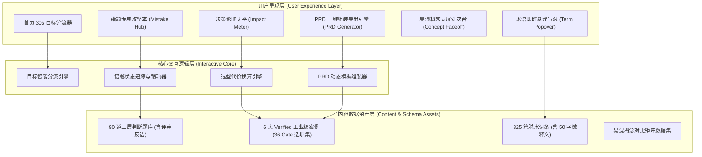
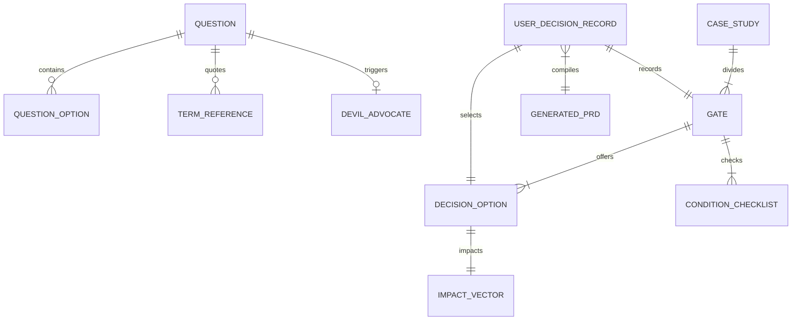
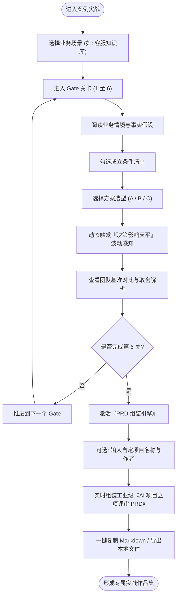
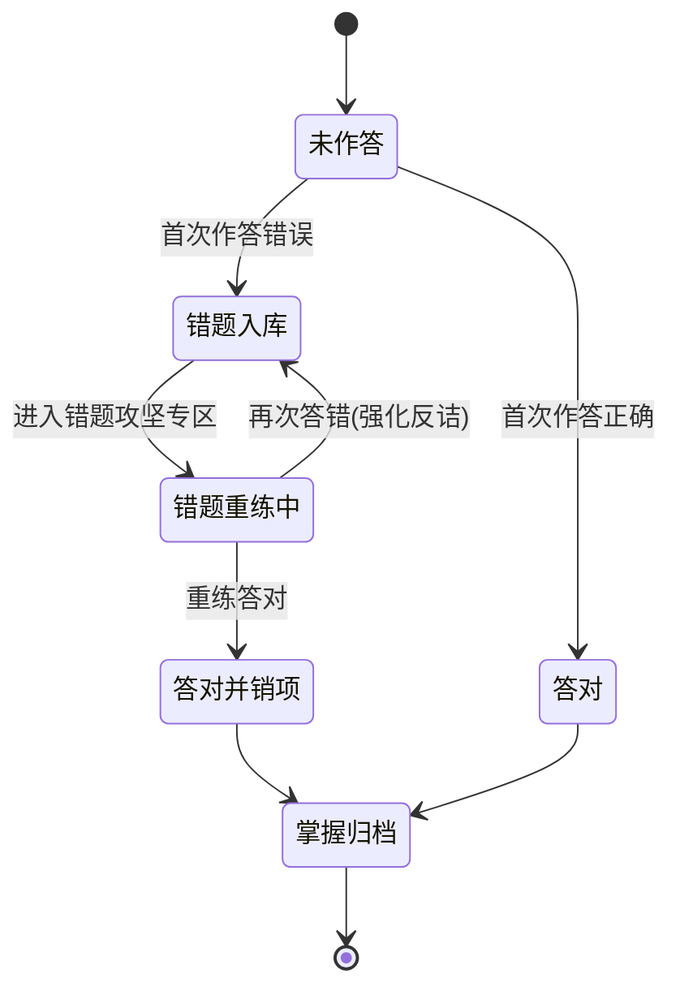

# AI-Native 学习体验升级与方案生成工作台 PRD

| PRD 审核人   | 待评审                               |
| ------------ | ------------------------------------ |
| 重要性       | 高                                   |
| 紧迫性       | 高                                   |
| 需求方       | AI 产品学习者 / 转型 AI 产品经理群组 |
| PRD 编写人   | AI-Native 产品架构团队               |
| PRD 提交日期 | 2026-09-30                           |

## PRD 修改记录

| 变更时间   | 变更内容                                             | 变更提出部门与理由                   | 修改人   | 审核人 | 版本号 |
| ---------- | ---------------------------------------------------- | ------------------------------------ | -------- | ------ | ------ |
| 2026-09-30 | 初始版本：基于纯用户体验与核心价值提升的整体重构方案 | 用户反馈：聚焦使用体验与实用交付价值 | 产品团队 | 待确认 | v1.0   |

---

## 1、项目背景

### 1.1 业务现状

AI-Native 是面向中文 AI 初学者与转型 AI 产品经理的落地型学习系统。当前系统已完成视觉体系重构（Daylight Clean 纯白高质感规范）、8 站认知链路、90 道三层递进判断题库、6 大 Verified 工业级实战案例（36 个 Gate 决策台）以及 325 个严谨词条的脱水沉淀。工程侧具备 100% 通过的自动化 CI 门禁与离线纯静态秒级检索。

### 1.2 面临问题

从终端用户的真实学习体验和实操价值切入，当前产品存在以下四大核心体验瓶颈（按严重程度排列）：

1. **P0 成果交付断层（投入产出比低）**：用户投入大量脑力完成 6 个案例的 36 个 Gate 复杂决策后，屏幕上仅留下一堆勾选过的静态页面，无法带走任何具备职场证明力（Portfolio）或工作复用价值的个人成果。
2. **P1 决策权衡反馈迟钝（缺少动态博弈直觉）**：在案例决策时，用户切换方案仅展示静态文字分析，缺乏对【开发周期、推理成本、准确率、兜底负荷】等关键工程指标波动的即时感知，无法形成敏锐的 PM 决策天平。
3. **P2 答题学习心流割裂（频繁被打断）**：90 道判断题在遇到陌生概念时必须跳出到独立词条页，打断答题节奏；错题缺乏二次聚合攻坚回路；解析缺乏真实业务评审维度的反诘模拟。
4. **P3 首页导向茫然（认知负荷过重）**：初次访问的用户面对 8 站、90 题、6 案例、300 词条，缺乏基于个人背景与目标的精准分流引导。

### 1.3 解决思路

将 AI-Native 从**「单向阅读型知识库」**升级为**「高价值决策演练与方案生成工作台」**：

- **成果资产化**：上线**「AI 产品立项评审 PRD 一键组装导出引擎」**，将用户在 Gate 中的选择自动沉淀为工业级实战文档（Markdown/PDF）；
- **感知动态化**：在案例 Gate 决策台中引入**「决策影响天平（Impact Meter）」**，实时反馈方案的代价波动；
- **心流无缝化**：全局上线**「术语即时悬浮气泡（Popover）」**、**「真实评审会反诘视角」**与**「错题攻坚重练模式」**；
- **入口目标化**：首页增加**「30 秒极简目标分流引导」**。

### 1.4 决策依据

- 用户真实使用痛点反馈：“学了半天，面试或汇报时拿不出东西”、“不知道怎么把题目结论变成自己公司的方案”；
- 认知心理学契约：主动构建型任务（输出 PRD、权衡指标）的知识留存率（75%）远高于被动单选输入（20%）。

---

## 2、需求基本情况

> 💡 方法论提示：应用用户旅程地图（User Journey Map）识别从“首次进入”到“获得成果”的关键体验断点。

### 2.1 目标用户画像

1. **传统互联网 PM（转型诉求）**：拥有丰富业务逻辑思维，但对大模型准确率陷阱、幻觉容错机制、Token 成本算力账本缺乏实操经验。核心诉求是**“快速掌握 AI 独有设计方法，并产出一份能拿去面试的实战作品集”**。
2. **AI 技术初学者 / 业务骨干（探索诉求）**：希望知道具体业务场景（如客服、合同审核）到底能不能用 AI 做，应该怎么做。核心诉求是**“看懂前沿概念，不再被技术忽悠，搞清方案利弊”**。

### 2.2 核心用户使用旅程对比

| 旅程环节    | 现状体验                        | 升级后体验                                    |
| ----------- | ------------------------------- | --------------------------------------------- |
| 1. 首页着陆 | 面对四大入口产生选择犹豫        | 30 秒快捷自测，一键直达对应链路起点           |
| 2. 答题训练 | 遇生词跳出网页；选完看枯燥解析  | 悬浮微卡即查生词；答错触发研发/业务评审反诘   |
| 3. 弱项复盘 | 做错当场看一眼，之后无痕遗忘    | 自动进入「错题本」，一键专项错题销项          |
| 4. 案例实战 | 从预设 4 选项选其一，纯文字阅读 | 切换选项实时联动「决策影响天平」雷达波动      |
| 5. 学习交付 | 通关 6 关后无成果，关闭网页离场 | **一键生成专属《AI 产品立项 PRD》，直接带走** |

---

## 3、同类工具调研与痛点优先级

### 3.1 现有同类学习产品局限

1. **通用 AI 知识库（如各类 Awesome-LLM）**：静态文档罗列，信息颗粒度极其碎片化，无业务情境与决策判断。
2. **大模型 API 编程课（如各类 LangChain 实战教程）**：侧重代码调用与环境搭建，避谈业务边界、失败降级、ROI 成本控制与人机协同。
3. **传统 PM 培训网站**：套用传统软件的表单和流程，对大模型的不确定性与概率生成本质缺乏深度建模。

### 3.2 用户痛点优先级矩阵

```
  紧迫度 (Urgency)
    高 ▲
       │  [P1 术语悬浮即查]         [P0 案例一键生成PRD导出]
       │  [P1 错题攻坚重练]         [P0 决策影响天平反馈]
       │
       │  [P2 首页目标分流]         [P1 评审会反诘视角]
       │  [P2 易混概念分屏对比]      [P2 架构流向动效图]
       └────────────────────────────────────────► 影响范围/价值 (Impact)
         低                                     高
```

---

## 4、项目收益与体验目标

> 💡 方法论提示：基于体验与效能的 HEART 框架（Task Success, Happiness, Engagement）。

### 4.1 核心体验提升指标

- **单关卡决策成果转化率**：完成 6 个 Gate 决策的用户中，触发「导出 PRD / 复制文档」的转化率 $\ge 65\%$；
- **答题心流连续度**：答题过程中跳出页面查阅词条的比例降低 $80\%$（由浮层气泡满足查询需求）；
- **错题掌握闭环率**：加入错题本的题目二次重练通过率 $\ge 85\%$；
- **决策思考深度感**：用户在 Gate 切换不同选项查看「决策天平」波动的平均尝试次数 $\ge 2.4$ 次/关。

---

## 5、项目方案概述

方案围绕**「建立端到端无阻断的实战心流」**构建三大功能支柱：

1. **输入端（心流护航）**：首页 30 秒极简目标分流导航 + 全局术语即时悬浮卡片（Popover），消除迷茫与跳出；
2. **交互端（深度决策）**：评审会反诘质询视角 + Gate 决策影响天平（成本/周期/精度/人机负荷四维联动）+ 错题攻坚本；
3. **输出端（成果交付）**：案例决策一键组装《AI 产品可行性评审 PRD》导出引擎（Markdown/PDF/一键复制）。

---

## 6、项目范围与迭代路线目标

### 6.1 迭代路线演进矩阵（Roadmap & Milestones）

```
┌────────────────────────────────────────────────────────────────────────┐
│                        AI-Native 体验提升迭代路线                        │
├─────────────────────┬────────────────────┬─────────────────────────────┤
│   Phase 1 (M1)      │    Phase 2 (M2)    │        Phase 3 (M3)         │
│   核心心流与成果闭环   │    决策深度与复盘增强 │        直觉图解与对决体验     │
├─────────────────────┼────────────────────┼─────────────────────────────┤
│ · 案例 PRD 一键导出   │ · 决策天平动态仪表盘 │ · 易混概念同屏 PK 对决台     │
│ · 术语即时悬浮气泡   │ · 评审会反诘质询视角 │ · 核心词条架构动效图解      │
│ · 首页极简目标分流   │ · 错题攻坚重练专区   │ · 痛点驱动题库场景速查      │
└─────────────────────┴────────────────────┴─────────────────────────────┘
```

### 6.2 分阶段里程碑目标

- **Phase 1 目标（2周，完成实战交付物与基本心流）**：
  - 核心功能：完成 6 个案例的 PRD 组装引擎，支持一键生成规范 Markdown 并复制；全站核心题目上线 Term Popover；首页上线 3 目标快捷分流。
  - 交付验收：用户走完案例即可导出一份结构严密的立项 PRD；做题不再需要开新标签页查词。
- **Phase 2 目标（2周，完成决策动态感知与学习闭环）**：
  - 核心功能：Gate 决策影响天平（Impact Meter）；90 题补齐「评审会反诘（Devil's Advocate）」内容；上线本地错题本与一键重练功能。
  - 交付验收：决策时能直观感受代价取舍；做错的题随时可挑出来专项消灭。
- **Phase 3 目标（2周，完成知识直觉图解与选型对决）**：
  - 核心功能：上线「易混概念对决台（Concept Faceoff）」；为 MCP、RAG、Agent、Prompt Cache 等 10 大核心概念增加交互式架构卡片。
  - 交付验收：模糊概念可一键分屏对比，彻底弄清技术选型边界。

---

## 7、项目风险与应对策略

| 风险类别 | 风险描述                                 | 严重度 | 应对措施                                                                                                      |
| -------- | ---------------------------------------- | ------ | ------------------------------------------------------------------------------------------------------------- |
| 体验风险 | PRD 导出内容过于模板化，用户觉得千篇一律 | 高     | 导出引擎深度绑定用户在各 Gate 中的**具体选项差异、勾选的风险项与特定参数**，不同选项生成差异化极大的方案章节  |
| 性能风险 | 浮层气泡与动效过多导致移动端卡顿         | 中     | 采用轻量原生 DOM + CSS Transitions 令牌，浮层数据按需纯前端内联或微模块加载，避免重绘抖动                     |
| 认知风险 | 决策天平的数值若显得武断会被质疑         | 中     | 数值以「相对等级变化（例如：Token成本 +80%，开发周期 -50%）」配合定性解释，不编造虚假绝对值，保留真实工程弹性 |

---

## 8、术语表

| 术语                            | 定义说明                                                                                          |
| ------------------------------- | ------------------------------------------------------------------------------------------------- |
| **Gate 决策台**                 | 案例实战中的关键里程碑关卡（每个案例包含 6 个 Gate，对应 AI 产品从边界判定到上线评估的 6 阶段）。 |
| **Impact Meter (决策天平)**     | 呈现用户在做出特定方案选型时，各项代价（开发周期、成本、精度、人机负荷）波动的可视化工具。        |
| **Term Popover (术语气泡)**     | 在做题或阅读过程中，悬停/轻触术语即时弹出的微缩释义卡片，包含本质定义、直观比喻与边界。           |
| **Devil's Advocate (评审反诘)** | 模拟业务干系人、研发架构师或法务团队在方案评审会上针对不良决策给出的针锋相对的质问。              |
| **Concept Faceoff (概念对决)**  | 针对两个高频易混淆的 AI 概念，提供左右分屏的定义对比、架构区别与选型决策树。                      |

---

## 9、参考文献与方法论依据

1. **Google People + AI Research (PAIR) Guidebook**：人机协同、交互容错与置信度校准设计；
2. **NIST AI Risk Management Framework (AI RMF 1.0)**：AI 风险治理、边界限定与评测指标分类；
3. **《决胜 B 端》**：B 端业务产品设计闭环、PRD 规范与决策权衡模型；
4. **Cognitive Load Theory (Sweller, 1988)**：即时气泡减少分心与认知阻断。

---

## 10、核心功能需求详解

### 10.1 产品框架概述

#### 应用架构图



#### 数据模型图（核心实体关系）



#### 业务主流程图（实战与成果生成流）



#### 状态机图（错题状态流转）



#### 功能清单表

| 模块编码 | 模块名称     | 核心功能点                                            | 优先级 |
| -------- | ------------ | ----------------------------------------------------- | ------ |
| F-01     | 首页目标分流 | 30 秒快捷自测、3 目标一键直达推荐起点                 | P1     |
| F-02     | 术语悬浮气泡 | 题目与正文内术语悬停即查、50字精释、比喻与边界        | P0     |
| F-03     | 评审反诘视界 | 选项解析补充「研发/业务评审会反诘」真实博弈视角       | P1     |
| F-04     | 决策影响天平 | 案例选项切换时，周期/成本/准确率/人机负荷实时雷达仪表 | P0     |
| F-05     | PRD 组装导出 | 案例 6 关决策结果一键装配为标准立项 PRD 并导出        | P0     |
| F-06     | 错题攻坚专区 | 错题自动归集、专项重做、掌握销项流转                  | P1     |
| F-07     | 易混概念对决 | 典型概念左右分屏对比、选型决策树、架构图解            | P2     |

---

### 10.2 核心模块需求详解

#### 10.2.1 案例 PRD 一键组装导出引擎 (F-05)

- **页面入口**：案例第 6 关（Gate 06）通过后，底部主操作区除“查看项目档案概览”外，显著展示 **「组装我的《AI 产品立项 PRD》」** 高亮按钮。
- **配置弹窗/面板**：
  - 项目名称（默认带入案例标准名，支持用户修改为自己的业务代号，如“某跨境电商客服 RAG 助手立项方案”）；
  - 编制人姓名 / 岗位（选填）；
  - 包含章节勾选（默认全选）：1. 业务背景与人机边界、2. 方案选型与技术路径、3. 容错与兜底应急预案、4. 评测指标与阈值、5. 上线分级演进计划。
- **组装规则**：
  - 自动读取用户在 Gate 01 ~ Gate 06 实际选择的选项分支；
  - 若用户在 Gate 02 选择了“检索增强 RAG 方案”，PRD 方案章节将渲染对应 RAG 架构设计与 Token 预算，而非硬编码套话；
  - 自动带入用户勾选的“关键假设条件”作为 PRD 的“前置依赖项”；
- **输出交互**：
  - 页面提供完整渲染预览（带规范 Markdown 排版）；
  - 提供 **「一键复制 Markdown（带富文本样式）」** 与 **「保存为 .md 文件」** 双按钮；
  - 按钮点击后触发按压触觉反馈与绿色成功 Checkmark 动效（持续 1.8 秒）。

#### 10.2.2 决策影响天平（Impact Meter）(F-04)

- **展示位置**：案例各 Gate 决策选项卡片右侧（桌面端）或选项下方（移动端）。
- **指标构成**：
  1. **开发交付周期**（快速上线 ↔ 长期研发）
  2. **推理运行成本**（低 ↔ 极高）
  3. **确定性与准确度**（80% ↔ 99% 严格防幻觉）
  4. **人工兜底介入率**（全自动 ↔ 高度依赖人工）
- **交互逻辑**：
  - 用户鼠标悬停或轻触选项 A、B、C 时，天平的 4 条进度柱或微型雷达立即执行平滑过渡动效（150ms `cubic-bezier(0.22, 1, 0.36, 1)`）；
  - 柱状条使用语义色：绿色（优势/低代价）、橙色（可控代价）、红色（显著风险/重负荷）；
  - 选中项后，天平锁定该状态，并在下方展开 1 句话精准代价警示（例如：“_选择纯 Prompt 方案可节省 3 周时间，但在专业长尾问答上可能发生严重幻觉，需要设置降级安全阀_”）。

#### 10.2.3 术语即时悬浮气泡（Term Popover）(F-02)

- **触发形式**：题干、选项与案例正文中的专业术语（带有轻微虚线底纹与浅蓝标示）。鼠标悬停（Hover 200ms 触发）或移动端轻触。
- **气泡卡片结构**：
  - 标题：中文术语 + 英文原词
  - 本质一句话（不超过 50 字）
  - 生活直觉比喻（如：“_Token 相当于大模型的字词按量收费计价器_”）
  - PM 必须记住的一句话边界（如：“_Prompt 无法代替外部新事实的注入，事实缺失必须上 RAG_”）
  - 底部提供「在知识库查看完整 9 段决策解析 →」极小文字链接。
- **体验约束**：
  - 气泡自动避让屏幕边缘，绝不超出视口；
  - 离开热区 250ms 后平滑淡出，不阻挡正常阅读。

#### 10.2.4 错题攻坚重练专区 (F-06)

- **入库机制**：在 `/learn/questions/[id]` 中，用户点击错误选项并提交后，该题目 ID 自动加入错题集合。
- **界面入口**：学习中心 `/learn/` 顶部状态栏及结业页，新增「错题攻坚本（N 题待消灭）」快捷按钮。
- **攻坚流程**：
  - 点击后进入专注答题模式（仅循环答错的题目）；
  - 选项重新打散顺序，防止机械记忆位置；
  - 重新答对后，界面给予积极的「已成功消灭」正向动效，错题计数动态递减。

---

### 10.3 异常情况处理方案

1. **浏览器 LocalStorage 禁用或满额异常**：
   - 页面顶部提示微弱信息：“当前处于无痕浏览或本地存储受限，做题进度仅在本次会话生效”，不阻断用户的正常答题与 PRD 查看。
2. **PRD 导出复制权限被系统拦截异常**：
   - 当调用 `navigator.clipboard` 失败时，自动优雅降级为在界面弹出全选文本框（`<textarea readonly>`），并高亮文字提示“已全选，请按 Ctrl+C / Cmd+C 复制”。
3. **屏幕尺寸极端狭窄（< 360px）异常**：
   - 决策天平从并排模式自动折叠为单列垂直紧凑条；
   - 术语气泡自动升格为底部呼出的微型底部浮层（Bottom Sheet），确保不出现横向滚动条。

---

## 11、数据埋点与体验分析

> 💡 方法论提示：纯粹围绕体验漏斗与用户价值转化，不收集个人隐私。

| 事件名称                | 触发时机                 | 关键上报参数                     | 体验分析目的                             |
| ----------------------- | ------------------------ | -------------------------------- | ---------------------------------------- |
| `term_popover_view`     | 用户触发术语悬浮气泡     | `term_id`, `source_page`         | 分析哪些术语最容易造成理解卡点           |
| `devil_advocate_expand` | 用户查看评审会反诘解析   | `question_id`, `selected_option` | 衡量反诘质询视角的启发性与阅读率         |
| `impact_meter_toggle`   | 用户在选项间切换查看天平 | `gate_id`, `toggle_count`        | 衡量决策代价对比工具对权衡思考的促进程度 |
| `prd_generate_click`    | 用户点击生成 PRD 方案    | `case_id`, `gate_count`          | 衡量终极交付物对用户的核心吸引力         |
| `prd_copy_success`      | 用户成功复制或下载 PRD   | `case_id`, `export_format`       | 评估实战成果真正被带走的转化率           |
| `mistake_redo_success`  | 用户在错题本中重做成功   | `question_id`, `attempt_count`   | 衡量错题复习闭环的实际掌握率             |

---

## 12、角色和权限

作为免登录体验型工作台，本系统无需复杂 RBAC，针对单用户提供完全自洽的客户端控制能力：

- **前台学习者**：
  - 享有全部链路学习、答题演练、方案组装与 PRD 导出权限；
  - 享有随时一键重置当前案例选择或清空错题本的自主控制权（Data Sovereignty）。

---

## 13、上线与运营计划

### 13.1 种子体验官内测（第 1 周）

- 邀请 10 位传统互联网产品经理与 5 位初入 AI 领域的应届生进行深度可用性走查（Usability Testing）；
- 核心走查任务：让他们挑选一个最关心的案例（如客服知识库），从头到尾完成 6 关决策并导出一份 PRD，观察他们在哪里产生犹豫、导出的文档是否达到面试/工作立项标准。

### 13.2 体验优化与打磨（第 2 周）

- 依据体验官反馈，微调 PRD 模板的措辞专业度，补充真实工业标准引用；
- 优化术语悬浮窗的触控灵敏度与天平波动的直观感。

---

## 14、待决事项 (TBD)

1. **[TBD-01] PRD 导出的格式丰富度**：第一期优先支持带有标准层级的 Markdown 与一键带格式复制，未来是否需要通过纯前端库直接生成带有目录大纲的 `.docx` 或 `.pdf` 文件？
2. **[TBD-02] 概念对决台的覆盖量**：第一批精选 10 组最高频的易混概念对（如 RAG vs 微调），后续是否允许用户通过交互式投票挑出他们最混淆的配对？

---

## 附：自检与待完善清单

- [x] **需求聚焦性**：严格剔除数据留存、商业变现与账号门槛，100% 聚焦于终端用户使用心流与成果产出。
- [x] **成果实战性**：补全了由 6 大案例直接一键组装《AI 产品立项 PRD》的完整技术与交互规格。
- [x] **图表规范性**：采用 Mermaid 完整绘制应用架构图、数据模型图、业务流程图与状态机图。
- [x] **迭代明确性**：拆解了清晰的 Phase 1 / Phase 2 / Phase 3 开发路线与里程碑目标。
